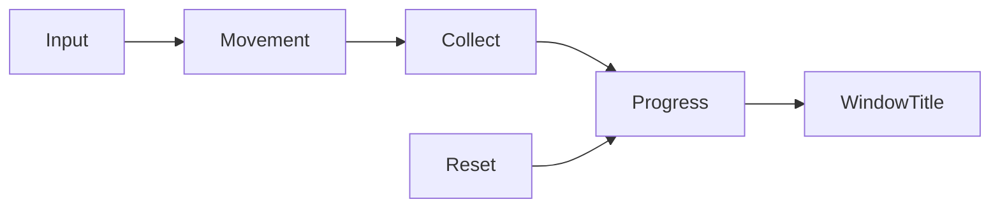

# Technical architecture

The crate has a pure rules module (`src/lib.rs`) and an executable Bevy shell (`src/main.rs`).

The ExplorationPlugin initializes the Run resource, spawns entities in Startup, and chains reset, movement, collect and update_title in Update. Player and Fragment are ECS components. The deterministic advance function is exercised by integration tests in tests/exploration.rs.

This is human-authored documentation. It does not claim to be automatically generated or current after subsequent edits. Source files remain authoritative.
